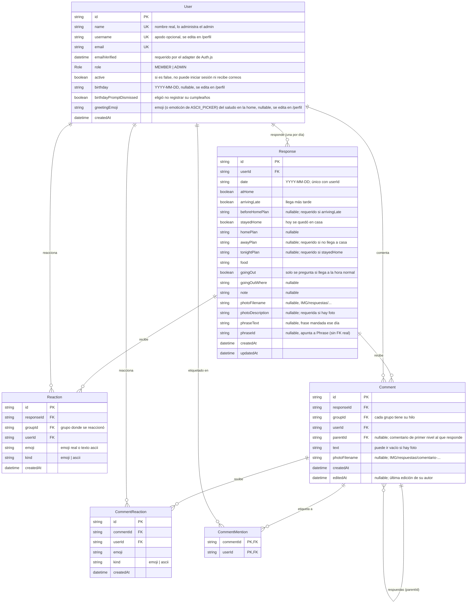
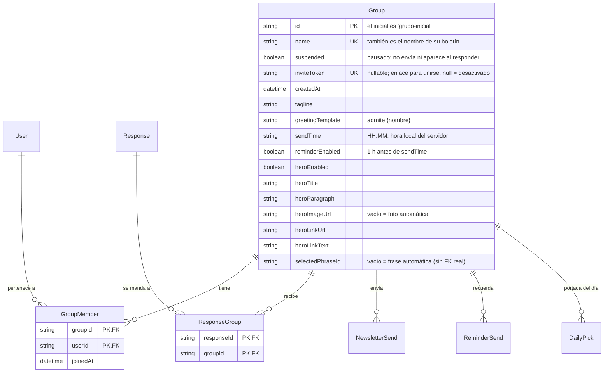
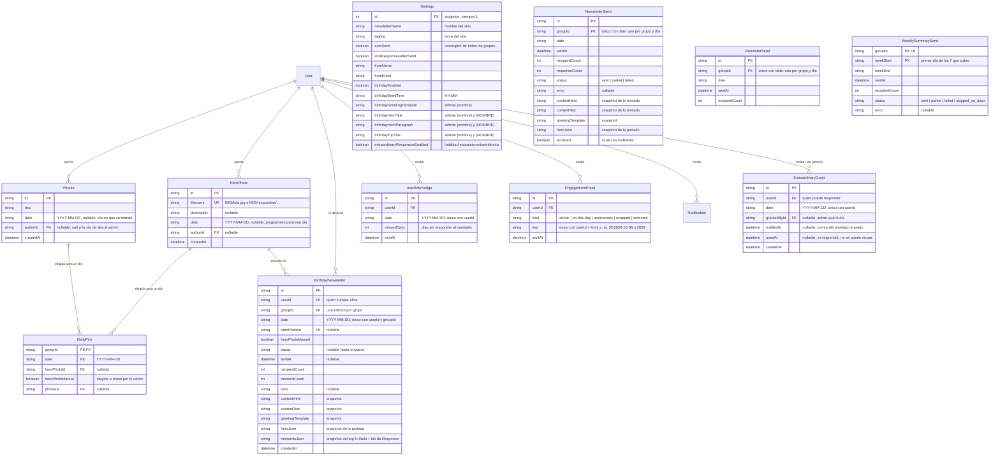
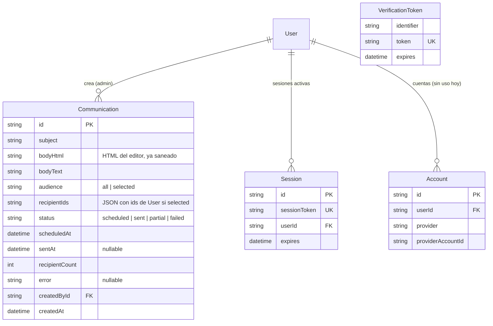

# Base de datos

> Ver también: [`ARQUITECTURA.md`](./ARQUITECTURA.md). Fuente de verdad
> real: `prisma/schema.prisma` — si este documento y el schema alguna vez
> no coinciden, el schema manda.

SQLite (`data/app.db`, gitignored), un solo archivo, Prisma 7 con driver
adapter (`@prisma/adapter-better-sqlite3`), sin query engine embebido.
Cliente generado en `src/generated/prisma` (también gitignored, se
regenera con `npx prisma generate`).

## Diagrama entidad-relación

Dividido en tres partes para que se lea; las relaciones con `User` se
repiten donde hace falta.

### Respuestas e interacción

### Misiones

- **`Mission`**: catálogo; `text` lleva `{usuario}`. Una misión que ya se
  usó no se borra, se desactiva (`active = false`).
- **`MissionAssignment`**: una oferta a `userId` para `targetId`. `date`
  es la fecha del resumen en que se entrega (y el "día" de los límites).
  `status`: `OFFERED` → `ACCEPTED` → `COMPLETED` (con `resolutionText`,
  `photoFilename` y `responseId`) o `FAILED`; también `REJECTED` y
  `CANCELLED`. `swaps` cuenta los "Cambiar actividad".
- **En `User`**: `missionStrikes`, `missionBanUntil` y `missionOptOut`.

### Grupos

### Boletines, portada y envíos

### Comunicaciones y autenticación

## Notas sobre el modelo

### Usuarios

- **`User.name` vs `User.username`**: `name` es el nombre real, lo pone el
  admin y es único. `username` es un apodo opcional (también único, pero
  `NULL` no choca consigo mismo en SQLite) que cada quien edita en
  `/perfil`. Todo lo público (boletín, comentarios, reacciones) usa
  `username` si está puesto y si no `name` — ver `src/lib/display-name.ts`.
  El saludo del correo sí usa siempre `name`.
- **`User.active = false`** no borra nada: la persona no puede iniciar
  sesión ni recibe correos (boletín, recordatorio, avisos de interacción),
  pero sus respuestas siguen en el historial.
- **`User.birthday`** es la fecha completa, pero solo se usan mes y día
  (ver "Boletín de cumpleaños" abajo).

### Respuestas

- **`Response` es única por `(userId, date)`**: volver a responder el
  mismo día actualiza la fila. `date` es un string `"YYYY-MM-DD"`, no un
  `DateTime`, para no lidiar con zonas horarias al comparar fechas.
- **Dos formatos en la misma tabla** (`format`): `DAY` es el resumen del
  día (`didToday`, `wentWhere`, `bestPart`, `worstPart`, `tomorrowPlan`,
  `mood`; `atHome` guarda "¿Te quedaste en tu casa?", `food` "¿Qué
  comiste?" (`""` si no contestó) y `note` "Algo que quieras compartir").
  `HOME` es el formato anterior, solo de consulta: sus cuatro flujos
  (`atHome`, `arrivingLate`, `stayedHome`), `goingOut`, etc. En un `DAY`
  esos campos quedan vacíos.
- **`date` es la fecha del boletín**: en `DAY` el resumen habla del día
  anterior (`describedDate()` en `src/lib/date.ts`).
- **Foto de la respuesta**: el archivo vive en `data/uploads/respuestas/`
  (fuera de `public/`, ver `ARQUITECTURA.md`), pero `photoFilename` guarda
  el nombre lógico `IMG/respuestas/<archivo>`, que es la URL con la que
  se sirve. Además se da de alta como `HeroPhoto` (con autor y fecha) para
  entrar a la rotación de portadas.
- **Frase de la respuesta**: `phraseText` guarda el texto (para precargar
  el formulario al editar) y `phraseId` apunta a la fila creada en
  `Phrase`, para actualizarla en vez de duplicarla. No es FK real.

### Grupos

- **`Group`**: cada grupo tiene su propio boletín y está aislado de los
  demás. Solo los admins los crean y gestionan. Una persona puede estar en
  varios (`GroupMember`).
- **`ResponseGroup`**: a qué grupos va cada respuesta. Una misma
  respuesta (una fila en `Response`) puede ir a varios grupos. Si al
  guardarla no va a ninguno, se manda a todos los grupos activos de su
  autor (`ensureResponseGroups()` en `src/lib/groups.ts`).
- **Grupo inicial**: la migración que introdujo los grupos creó
  `grupo-inicial` (con el nombre del boletín de ese momento) con todos los
  usuarios y todas las respuestas que ya existían. Al dar de alta a
  alguien se eligen sus grupos.
- **Ajustes del boletín por grupo**: saludo, hora, recordatorio, portada
  y frase fija viven en `Group` (antes en `Settings`; la migración los
  copió al grupo inicial). `NewsletterSend`, `ReminderSend` y `DailyPick`
  son por `(groupId, date)`; lo enviado antes de los grupos quedó en el
  grupo inicial.

### Interacción

- **Por grupo**: `Reaction` y `Comment` llevan `groupId`. Una respuesta
  mandada a dos grupos tiene reacciones e hilo aparte en cada uno (las
  reacciones a un comentario van con el comentario).
- **`Reaction` y `CommentReaction`** son únicas por persona y emoji (por
  respuesta y grupo, o por comentario):
  una persona puede reaccionar con varios emojis distintos, pero solo una
  vez con cada uno; repetir el mismo lo quita (toggle). `kind` solo sirve
  para pintar distinto los emojis y los emoticones ascii. Están en tablas
  separadas para no mezclar reacciones a respuestas con reacciones a
  comentarios (p. ej. el top 5 de cumpleaños solo cuenta las primeras).
- **`Comment`** va en orden cronológico por respuesta; `parentId` apunta
  al comentario de primer nivel al que responde (un solo nivel de hilo).
  **`CommentMention`** guarda a quién se etiquetó en cada comentario.
- Todo se borra en cascada con la respuesta o con el usuario.

### Portada del boletín

- **`HeroPhoto` se sincroniza sola** con lo que haya en `public/IMG`
  (`syncHeroPhotos()` en `src/lib/hero-photos.ts`): agrega las fotos
  nuevas y borra las que ya no están en disco. Las fotos de respuestas
  (`IMG/respuestas/…`) se excluyen de esa limpieza porque viven en otro
  lado.
- **`DailyPick`** fija la foto y la frase de la portada de un día la
  primera vez que se resuelven (o cuando el admin las elige a mano o las
  re-rola), para que la vista previa y el envío real coincidan y la
  portada no cambie sola a media tarde.
- **`Group.selectedPhraseId`** no es FK real (vacío = modo automático);
  se resuelve en `src/lib/phrases.ts`. La foto y la frase automáticas de
  un grupo salen del catálogo y de las respuestas mandadas a ese grupo
  (`heroPhotosForGroup()`, `phrasesForGroup()`).

### Envíos

- **Idempotencia**: `NewsletterSend` y `ReminderSend` son únicos por
  `(groupId, date)`, `BirthdayNewsletter` por `(userId, groupId, date)` y
  `WeeklySummarySend` por `(groupId, weekStart)`. El worker revisa
  si ya existe el envío antes de mandar, así que aunque el cron corra de
  más o el proceso se reinicie, nunca sale dos veces lo mismo (salvo
  reenvío forzado desde el panel).
- **Snapshots congelados**: al enviarse, `NewsletterSend` y
  `BirthdayNewsletter` guardan el contenido tal cual salió
  (`contentHtml`, `contentText`, `heroJson` y, en cumpleaños,
  `momentsJson`). `/boletines` y el panel muestran eso en vez de
  reconstruirlo con los ajustes actuales, que pueden haber cambiado. Los
  envíos anteriores a esos campos los tienen vacíos y se reconstruyen.
- **`BirthdayNewsletter`** es tabla aparte de `NewsletterSend` porque el
  día del cumpleaños también salen los diarios de cada grupo. La fila
  nace al resolver la foto de portada (vista previa o envío) y hace de
  `DailyPick` de esa edición; `sentAt` se llena al enviarse.
- **`Communication`** son correos sueltos del admin, de inmediato o
  programados (`scheduledAt`); el worker manda los programados cuando
  llega su hora.
- **`WeeklySummarySend`** hace idempotente el resumen semanal (uno por
  semana, por `weekStart`). **`InactivityNudge`** guarda cada correo de
  "llevas N días sin responder": además de evitar repetirlo el mismo día,
  es el historial con el que se decide el siguiente (a los N, 2N, 3N…
  días de la misma racha; ver `pendingInactivityNudges()`).
- **`Notification`**: copia en el sitio de cada correo mandado a alguien
  (`html` con el correo, o `url` a donde lleva si no se guarda);
  `readAt` null = sin leer. Se borran a los 365 días.
- **`EngagementEmail`** hace idempotentes los correos especiales (racha,
  "hace un año", aniversario, resumen anual, bienvenida).
- **`ExtraordinaryGrant`**: privilegio de un solo uso para responder un
  día pasado desde `/respuesta-extraordinaria`. `notifiedAt` null =
  todavía no se le avisa (la página estaba deshabilitada); `usedAt` se
  llena al guardar la respuesta. Los días con alguno usado salen en
  `/boletines` aunque ese día no haya `NewsletterSend`.
- **`User.lastSeenAt`**: última vez que la persona abrió el sitio con
  sesión; ver `src/lib/last-seen.ts` para cómo se combina con sesiones y
  actividad.

### Otros

- **`Settings` es un singleton**: siempre `id = 1`, se crea con
  `upsert` la primera vez que hace falta, sin seed obligatorio.
- **`Account` / `Session` / `VerificationToken`** son los modelos estándar
  de `@auth/prisma-adapter`. `Account` existe por completitud, pero no
  hay login social: solo enlace mágico por correo.
- **Migraciones** en `prisma/migrations/`, aplicadas con
  `npx prisma migrate deploy` (nunca `migrate dev` fuera de desarrollo
  local). En SQLite, para agregar columnas se prefiere `ALTER TABLE …
  ADD COLUMN` escrito a mano: el `migrate diff` de Prisma a veces propone
  recrear la tabla completa, que es más riesgoso sobre datos reales.
